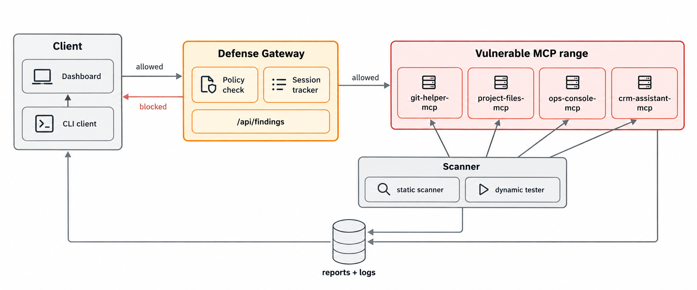

# MCP Security Auditor & Defense Gateway

**A scanner that finds real vulnerabilities in MCP servers, and a live gateway that blocks them — including a sequence-level attack that no single call reveals.**

AI agents increasingly call external tools through MCP (Model Context
Protocol) — and most MCP servers ship with little to no security by
default. Between January and April 2026 alone, researchers disclosed 40+
CVEs across the official MCP SDKs, several of them architectural rather
than implementation bugs. This project builds both sides of that problem:
a scanner that audits MCP servers for real vulnerability classes, and a
defense gateway that sits in front of them and blocks attacks in real
time — against 4 intentionally vulnerable servers built to model those
classes honestly.

📺 **[Watch the demo video](PASTE_YOUR_VIDEO_LINK_HERE)** — command
injection and path traversal getting blocked live, and a multi-step
exfiltration attack getting flagged even though no single call in it looks
wrong.

## Architecture



Three pieces, in the order they matter:
1. **Scan** — `scanner/` reads each server's declared config, then
   actually probes it live, and only calls a finding "confirmed" when both
   agree.
2. **Defend** — `gateway/` sits in front of every server, blocks known
   attack patterns before they land, and watches whole call *sessions* —
   not just individual calls — for the pattern that per-call filtering
   can't catch.
3. **Visualize** — `dashboard/` ties it together: real findings, real
   gateway activity, and a console where you can fire any of the 4 attacks
   live, from your browser, and watch the gateway respond.

## Quick start

```bash
git clone https://github.com/RaunitChatterjee/MCP-Security-Auditor-Defense-Gateway.git
cd MCP-Security-Auditor-Defense-Gateway
pip install -r requirements.txt

bash scripts/dev_up.sh          # starts all 4 vulnerable servers + the gateway
python3 -m client.harness discover
```

Then try any of the following:
```bash
python3 -m scripts.exploit1_cmdinj      # command injection — confirmed live
python3 -m scripts.exploit4_sequence    # the multi-step exfiltration attack
python3 -m scanner.scan                 # full findings report, severity-ranked
python3 -m scripts.gateway_demo         # the gateway blocking everything above
```

And the dashboard:
```bash
cd dashboard && npm install && npm run dev
```
It works standalone with a bundled real capture, or live against the
gateway above if it's running — see `dashboard/README.md`.

When you're done: `bash scripts/dev_down.sh`

## The 5 vulnerability classes

| Class | What it means | Modeled in |
|---|---|---|
| Command injection | A tool argument reaches a shell unsanitized — arbitrary commands run on the server | `git-helper-mcp` |
| Path traversal | A file tool doesn't check that the path it's given stays inside its own folder | `project-files-mcp` |
| Missing authentication | No identity check at all — any party that can reach the server can call any tool | `ops-console-mcp` |
| Over-permissioned tools | A tool built for one narrow task quietly accepts a parameter that lets it do far more | `crm-assistant-mcp` |
| Sequence-level exfiltration | Several individually-legitimate calls, chained, add up to a data leak no single call reveals | `project-files-mcp` → `crm-assistant-mcp` |

All mapped to the OWASP Top 10 for LLM Applications — see
`docs/day1_threat_model_notes.md` for the full threat model and
`docs/day4_ioc_reference.md` for exact payloads and indicators per class.

## Project structure

```
range/        4 intentionally vulnerable MCP servers + their manifest.json configs
client/       minimal MCP client (JSON-RPC 2.0 / Streamable HTTP)
scripts/      standalone exploit scripts, one per vulnerability class, with JSONL log capture
scanner/      static config scanner + live dynamic tester + severity-scoring engine
gateway/      transparent proxy, policy-based blocking, behavioral sequence detection
dashboard/    React/Vite dashboard — findings, gateway activity, and a live attack console
docs/         threat model, IOC reference, v2 roadmap
logs/ reports/  gitignored run output — a few real sample runs are committed as evidence
```

Each range server ships a `manifest.json` (self-declared auth posture, tool
scopes, install source) — that's what the static scanner reads, correlated
against what the dynamic tester actually observes live.

## Known limitations

Named on purpose, not hidden:

- **The dynamic auth probe only tests a server's first tool.** It
  false-negatived once during development (`project-files-mcp`'s missing
  auth) because that tool happened to error on the probe's placeholder
  input before the auth gap would show. The static scanner still caught it
  from the manifest — which is exactly why the report correlates two
  independent methods instead of trusting either alone.
- **The gateway's policy layer is a pattern blocklist, not a full parser.**
  A sufficiently obfuscated or encoded payload could likely slip past it.
- **The gateway doesn't enforce authentication itself** — that's the
  scanner's job (`AUTH-001`). Firing the "unauthenticated access" attack
  from the dashboard's live console correctly comes back *cleared*, not
  blocked, and says so.

## What's next

v2 generalizes the sequence detector into a full trust/attack-path graph
over agent tool chains — think BloodHound, but for MCP, reasoning about
every path an agent could take through a toolset instead of pattern-matching
one known attack shape. Full design doc: `docs/v2_roadmap.md`.

## Lessons learned

*(a few to start from — worth making these genuinely yours before this goes up)*
- The hardest attacks to catch are the ones where every individual step is
  legitimate — that's as true for AI agents as it's always been for
  insider threats and supply chains. It's a pattern-recognition problem,
  not a sanitization problem.
- Naming a tool's own limitations explicitly (the auth-probe gap, the
  policy blocklist) turned out to be more useful than it felt risky —
  it's what makes the "confirmed live" distinction in the findings report
  mean something.

## Built with

Python · FastAPI · React · Vite

## Links

- 🔗 [https://www.linkedin.com/in/raunit-chatterjee-00aa9a289/](#) — the project from problem statement to live demo, in 5 posts
- 🐛 Found something? Open an issue or a PR — see `docs/v2_roadmap.md` for where contributions would help most